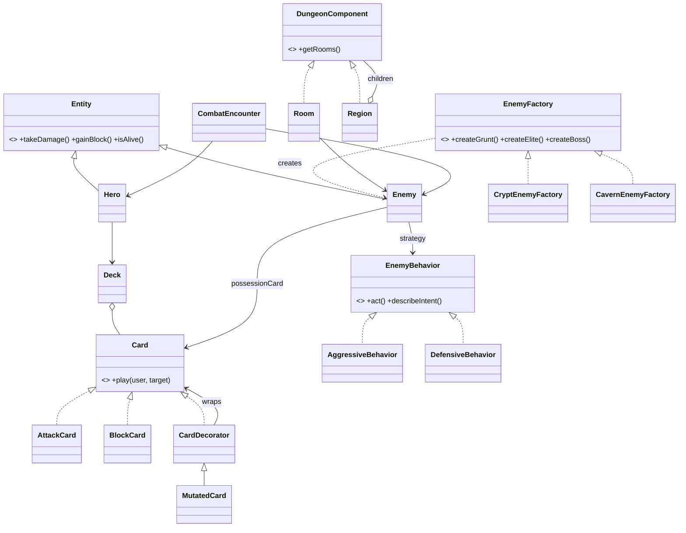

# Vessel

A dungeon-crawling, deck-building game written in Java with JavaFX.

The hero fights through the dungeon, **possesses** defeated enemies to steal their abilities as cards, and **mutates** as they go, slowly losing their humanity on the way to the exit.

**Developers:** Cole Younoszai, Sam Kutcipal

---

## Getting started

### Requirements
- JDK 21 or newer (developed on Temurin 25)
- IntelliJ IDEA (any recent version). You don't need to install Gradle or JavaFX: the Gradle wrapper downloads both.

### Open in IntelliJ
1. **File → Open…** and pick the `Vessel` folder (the one with `build.gradle` in it).
2. If IntelliJ asks, choose **Trust Project** and let the Gradle sync finish.
3. Make sure the project SDK is JDK 21+ (**File → Project Structure → Project → SDK**).

### Run the game
- In the **Gradle** tool window: **Vessel → Tasks → application → run**, or
- From a terminal in the project folder:

```bash
./gradlew run
```

(On Windows `cmd`/PowerShell, use `gradlew.bat run`.)

### Run the tests
- Right-click `src/test/java` → **Run 'All Tests'**, or:

```bash
./gradlew test
```

---

## How to play (current prototype)

1. Each room has one enemy. Its **intent** shows what it will do on its turn.
2. You get **3 energy** per turn and draw **5 cards**. Click a card to play it (the number in brackets is its energy cost).
3. Click **End Turn**. The enemy acts, your hand is discarded, and you draw a new hand.
4. When an enemy dies you choose:
   - **Possess**: add the enemy's signature card to your deck. It costs humanity, and one of your basic Strikes **mutates** (+3 damage).
   - **Leave the body**: move on unchanged.
5. You **escape** if you reach *The Surface*. You **die** at 0 HP, and you are **lost** at 0 humanity.

---

## Project structure

```
src/main/java/com/vessel/
├── Launcher.java              Entry point (starts JavaFX)
├── ui/VesselApp.java          JavaFX window: displays state, forwards clicks to the game rules
├── model/                     Entity (abstract), Hero, Enemy
├── cards/                     Card, AttackCard, BlockCard, CardDecorator, MutatedCard, Deck
├── strategy/                  EnemyBehavior, AggressiveBehavior, DefensiveBehavior
├── factory/                   EnemyFactory, CryptEnemyFactory, CavernEnemyFactory
├── dungeon/                   DungeonComponent, Room, Region, DungeonBuilder
└── combat/CombatEncounter.java   Turn rules for one fight (no UI code)
src/test/java/com/vessel/      JUnit 5 tests for cards, deck, combat and dungeon
```

The game rules (`model`, `cards`, `combat`, ...) know nothing about JavaFX. The UI only reads state and calls methods like `playCard`, `endTurn` and `possess`. That separation keeps the rules unit-testable and lets us redo the UI later without touching the game logic.

---

## Design patterns (from the proposal)

| Pattern | Kind | Where | Why it fits Vessel |
|---|---|---|---|
| **Abstract Factory** | Creational | `factory/EnemyFactory` → `CryptEnemyFactory`, `CavernEnemyFactory` | Each dungeon region produces its own *family* of themed enemies (grunt, elite, boss). The builder asks for "a grunt" without knowing which region it's in. |
| **Composite** | Structural | `dungeon/DungeonComponent` → `Room` (leaf), `Region` (composite) | The dungeon is a tree: regions contain rooms and sub-regions. `getRooms()`, `getRoomCount()` and `getEnemyCount()` work the same on a single room or the whole dungeon. |
| **Decorator** | Structural | `cards/CardDecorator` → `MutatedCard` | Mutations wrap an existing card and add to its behavior without changing the original class. They can stack (*Mutated Mutated Strike*). |
| **Strategy** | Behavioral | `strategy/EnemyBehavior` → `AggressiveBehavior`, `DefensiveBehavior` | How an enemy fights is a swappable object. New AI is a new class, and `Enemy` never changes. |



---

## What has been done (v0.1.0, first steps)

1. **Project setup:** Gradle project with the JavaFX plugin (JavaFX 21, `javafx.controls`), JUnit 5, Gradle wrapper 9.7.1, an application `run` task and a `.gitignore` for IntelliJ and Gradle output. It opens directly in IntelliJ.
2. **Core model:** `Entity` handles HP, block and damage. `Hero` adds a deck and humanity. `Enemy` adds a behavior, a possession card and a humanity cost.
3. **Cards and deck:** `AttackCard` and `BlockCard` are the base cards. `Deck` manages the draw pile, hand and discard pile, reshuffles the discard pile when the draw pile runs out, and supports `add`/`replace` for building the deck. The starter deck is 5 Strikes and 4 Guards.
4. **All four proposal patterns are implemented in small form**, as listed in the table above.
5. **Combat loop:** `CombatEncounter` handles energy, playing cards, ending the turn, the enemy's turn, the win/lose outcome and **possession** (gain the card, lose humanity, mutate a Strike).
6. **Dungeon:** `DungeonBuilder` builds two regions (Crypt → Caverns), each with grunt, grunt, elite and boss rooms, followed by an exit room.
7. **Playable JavaFX prototype:** a basic window that takes you room by room through the whole dungeon, with clickable cards, End Turn, Possess or Leave, a combat log, and win/death/lost end screens with *New Run*.
8. **Tests:** 15 JUnit tests covering damage and block, the decorator (including stacked mutations), deck draw/reshuffle/replace, combat energy and turns, possession, the composite room counts and the factory output. All pass with `./gradlew build`.

---

## What's next

Roughly in priority order. Split these between the two of us as GitHub issues.

### 1. Make it a real *tree* crawler
- [ ] Rooms currently come in a fixed straight line. Give each room a list of **next rooms** so the player **chooses a path** (similar to a Slay the Spire map).
- [ ] Add a map screen that shows the branches.
- [ ] Add non-combat room types: **Rest** (heal), **Shrine** (remove a mutation or regain humanity), **Treasure**.
- [ ] Randomize generation, picking the region factory per floor.

### 2. Deepen the possession / mutation system
- [ ] When possessing, let the player choose to **add** the card or **replace** an existing one (`Deck.replace` already exists). This is the add/replace step from the proposal.
- [ ] More decorators: `BurningCard` (damage over time), `CostReducedCard`, `DrainingCard` (heals the user), `CursedCard` (costs HP or humanity to play).
- [ ] Hero-level mutations: decorate the **hero** too (for example extra max HP but less humanity), possibly a `HeroDecorator`.
- [ ] Humanity thresholds that change the game (at 50 the hero's art changes, at 25 the starter cards start corrupting).

### 3. Better enemies (Strategy)
- [ ] More behaviors: `PatternBehavior` (cycles through a list of moves), `BerserkBehavior` (hits harder at low HP), `HealerBehavior`.
- [ ] Let an enemy **switch strategies** mid-fight (for example a boss phase 2). This shows off Strategy well.
- [ ] Bosses that use several behaviors.

### 4. UI and polish (JavaFX)
- [ ] Move the layout into **FXML** + CSS (Scene Builder) and keep `VesselApp` as a thin controller.
- [ ] Card art, enemy sprites, and health bars instead of text.
- [ ] A title screen and a deck viewer.
- [ ] Optionally use an **Observer** (JavaFX properties) so the UI updates automatically instead of calling `refresh()` by hand.

### 5. Engineering
- [ ] More tests as each feature lands (each pattern should have tests that show it working).
- [ ] Add a GitHub Actions workflow that runs `./gradlew build` on every push and PR.
- [ ] Optional: logging (Logback, as in earlier assignments) and save/load of a run.

---

## Putting this on GitHub

The local repo is already initialized with a first commit. To publish it:

1. On GitHub, create a **new empty repository** named `Vessel`. Don't add a README, `.gitignore` or license, because those already exist here.
2. In the project folder, run:

```bash
git remote add origin https://github.com/<your-username>/Vessel.git
```

```bash
git push -u origin main
```

3. Add your teammate under **Settings → Collaborators**.

You can also do this from IntelliJ with **Git → GitHub → Share Project on GitHub**.
